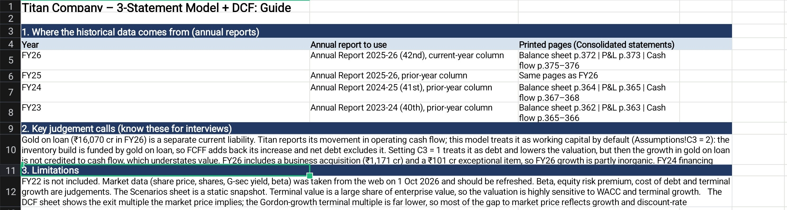
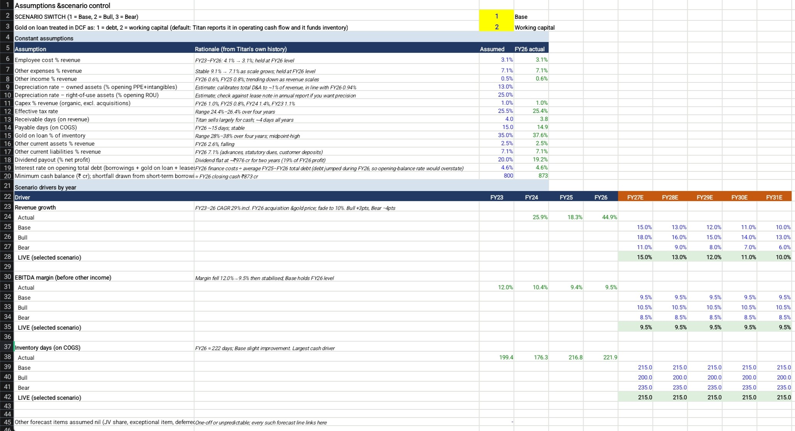
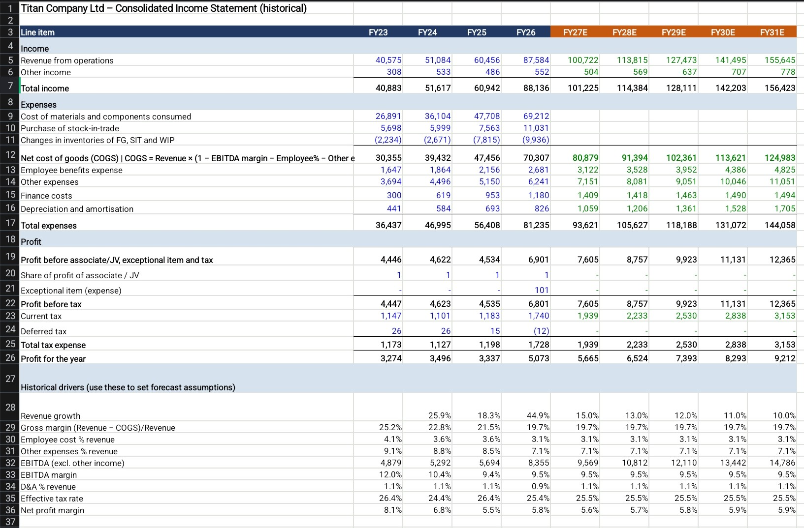
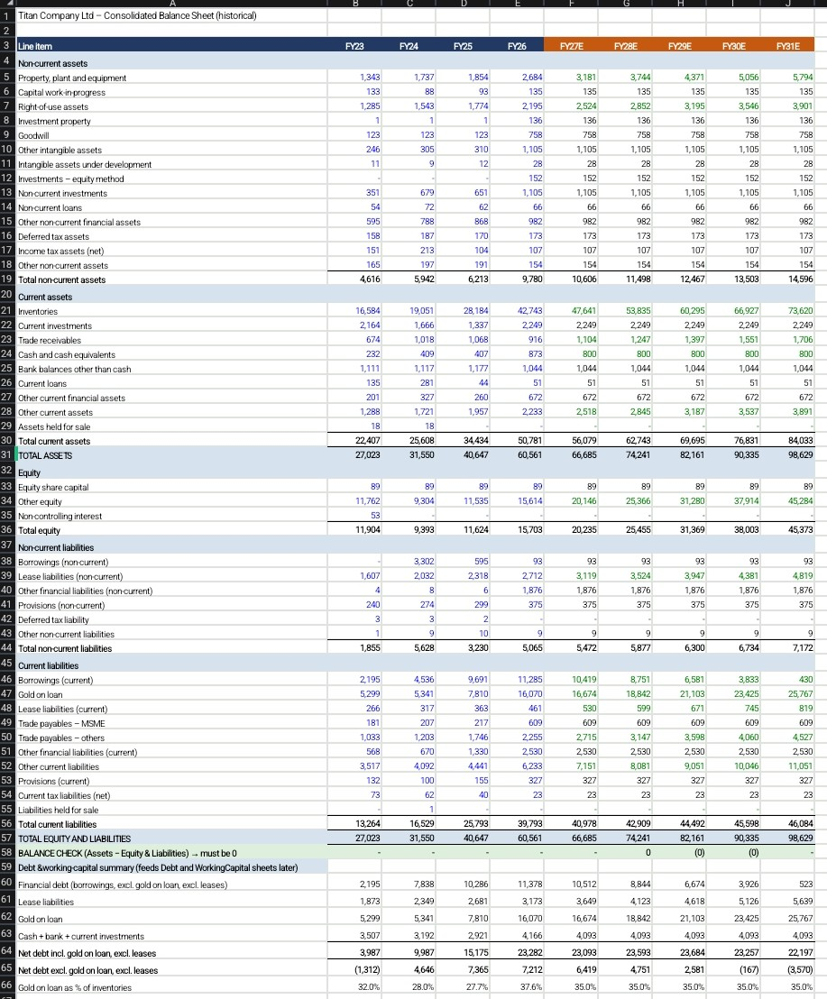
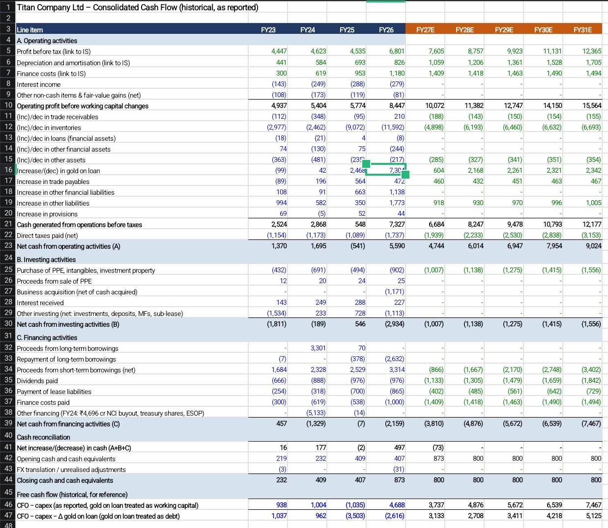
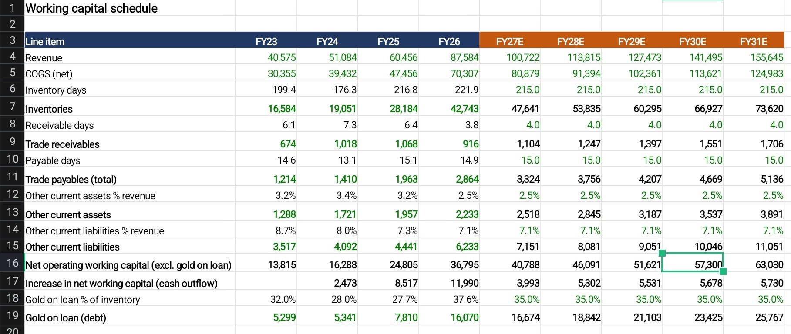
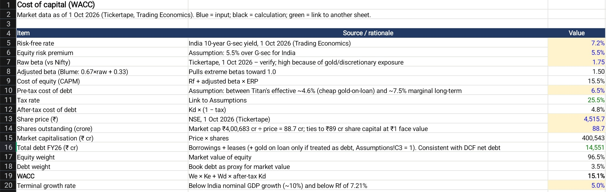
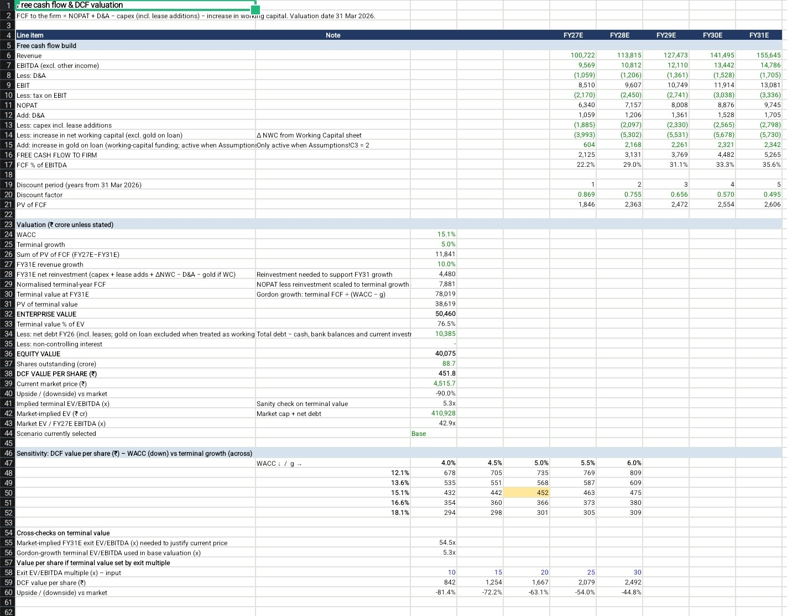
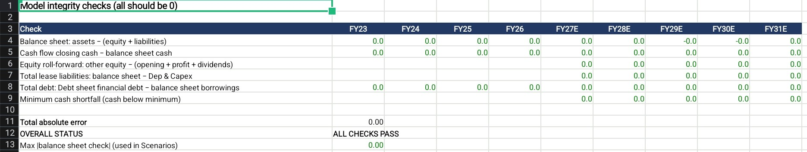
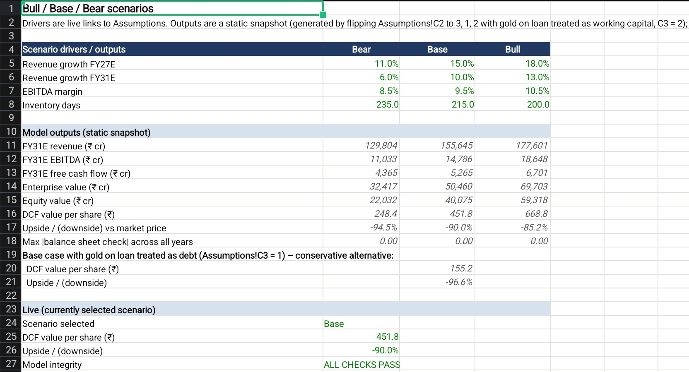

# Titan Company: 3-Statement Financial Model and DCF Valuation

## 1. Project Summary

An integrated three-statement model (income statement, balance sheet, cash flow statement) of Titan Company Ltd, built entirely in Excel. Historicals for FY23–FY26 come from the company's consolidated annual reports, and the model forecasts FY27E–FY31E. The forecast runs through linked schedules for depreciation and capex, working capital and debt, with a bull/base/bear scenario switch. Free cash flow to the firm is discounted at a CAPM-based WACC to give an intrinsic value per share, with a WACC vs terminal growth sensitivity table and a terminal-value cross-check. Gold on loan, a Titan-specific funding item, is handled explicitly, and a Checks sheet confirms the model balances in every year.

**Base-case result:** DCF value of about ₹452 per share against a market price of ₹4,516 (1 Oct 2026). The model does not justify the market multiple, and the README explains why (see Limitations).

| Item | Value |
|---|---|
| Historical period | FY23–FY26 (annual reports) |
| Forecast period | FY27E–FY31E |
| Valuation date | 31 March 2026 |
| Base-case WACC | about 15.1% |
| Terminal growth | 5.0% |
| Scenarios | Bull / Base / Bear |

---

## 2. Screenshots

| File | One-line description |
|---|---|
|  | Guide sheet: annual-report page references for each historical year and the key judgement calls. |
| | Assumptions sheet: scenario switch, gold-on-loan switch and the revenue, margin and inventory-day drivers by scenario. |
|| Income statement with FY23–FY26 actuals and FY27E–FY31E forecasts. |
| | Balance sheet, balancing in every historical and forecast year. |
| | Cash flow statement reconciling to the closing cash on the balance sheet. |
|| Working capital schedule: inventory, receivable and payable days, and the gold-on-loan funding of inventory. |
|| WACC build-up: risk-free rate, equity risk premium, adjusted beta, cost of debt and capital weights. |
| | DCF sheet: free cash flow build, terminal value, enterprise value to equity value, and value per share. |
| | Sensitivity of value per share to WACC and terminal growth, plus the exit-multiple cross-check. |
|| Bull / base / bear drivers and valuation outputs side by side. |
|| Integrity checks sheet showing every check at zero and the status "ALL CHECKS PASS". |

---

## 3. What Each Sheet Contains

The workbook is `model/Titan_3Statement_DCF_Final_Model-3.xlsx`. The 12 sheets fall into six groups.

**1. Guide and Assumptions (`Guide`, `Assumptions`)**
The Guide lists the annual-report pages used for each historical year, the key judgement calls and the model's limitations. Assumptions holds the scenario switch (bull/base/bear), the gold-on-loan treatment switch, constant ratios (employee cost, tax rate, receivable and payable days) and the year-by-year drivers for revenue growth, EBITDA margin and inventory days.

**2. Financial statements (`Income Statement`, `Balance Sheet`, `Cash Flow`)**
Consolidated statements for FY23–FY26 as reported, extended to FY27E–FY31E. All three are linked, so a change in any driver flows through profit, balance sheet and cash.

**3. Supporting schedules (`Dep & Capex`, `Working Capital`)**
Depreciation and capex cover owned assets and right-of-use (lease) assets. Working capital is driven by inventory, receivable and payable days, with gold on loan modelled as a share of inventory because it funds much of Titan's stock.

**4. Debt (`Debt`)**
Borrowings, gold on loan and lease liabilities roll forward to total debt. Interest cost feeds back into the income statement, and net debt, net debt/EBITDA and interest cover are tracked each year.

**5. Valuation (`WACC`, `DCF`)**
WACC uses CAPM (market data as of 1 Oct 2026). The DCF discounts five years of free cash flow to the firm and adds a Gordon-growth terminal value. It bridges from enterprise value to equity value per share and includes a sensitivity table (WACC vs terminal growth) and an exit-multiple cross-check against the market-implied multiple.

**6. Scenarios and Checks (`Scenarios`, `Checks`)**
Scenarios compares bull, base and bear drivers and valuations, and also shows the result with gold on loan treated as debt. Checks tests balance sheet balance, cash reconciliation, equity roll-forward, lease and debt tie-outs and minimum cash in every year.

---

## 4. Limitations

- **Short history.** Only FY23–FY26 are used (four years of annual reports), and FY22 is not included. FY26 growth includes a business acquisition (₹1,171 cr) and a ₹101 cr exceptional item, so part of it is inorganic and not a clean base for forecasting. FY24 financing includes a ₹4,696 cr buy-out of minority holders.
- **Valuation is far below the market price.** The base case gives roughly ₹452 per share against ₹4,516. The terminal value implies about 5x FY31E EBITDA, while the market price implies roughly 55x. The gap reflects assumptions (discount rate, margins, growth fade) that cannot capture the premium the market pays for Titan's growth and brand, so this model should not be read as a price target.
- **Terminal value dominates.** About three-quarters of enterprise value comes from the terminal value, so the result is very sensitive to WACC and terminal growth.
- **Judgemental WACC inputs.** Beta (raw 1.75, Blume-adjusted to about 1.50), the 5.5% equity risk premium, the 6.5% pre-tax cost of debt and the 5% terminal growth rate are assumptions, not observed facts. Market data (price, shares, G-sec yield, beta) is dated 1 Oct 2026 and should be refreshed before relying on it.
- **Five-year horizon.** Growth is still 10% in FY31E and then drops to 5% in the terminal year. A longer forecast with a gradual fade would be more realistic.
- **Gold on loan is a judgement call.** The base case treats it as working capital, because Titan reports its movement in operating cash flow and it funds inventory. Treating it as debt cuts the base value to about ₹155 per share. Both are shown on the Scenarios sheet.
- **Simplified forecasts.** COGS is forecast in total, not by line. Non-current borrowings and the cash balance are held flat, and depreciation rates are estimates calibrated to about 1% of revenue. Interest income, exceptional items, acquisitions and FX are assumed nil.
- **Scenarios sheet is a snapshot.** Bull, base and bear outputs are static values generated by flipping the scenario switch. Re-run them after changing any assumption. The live block at the bottom of that sheet always follows the switch.
- **Public data only.** The model uses published annual reports and public market data. It is an educational and portfolio project, not investment advice.

---

## How to Use

1. Download the Excel file from `/model` and open it in Excel (formulas recalculate on opening).
2. Change the scenario with `Assumptions!C2` (1 = Base, 2 = Bull, 3 = Bear).
3. Change the gold-on-loan treatment with `Assumptions!C3` (1 = debt, 2 = working capital).
4. Check `Checks` for "ALL CHECKS PASS" after any change.

Colour code: blue = input, black = calculation, green = link to another sheet.

## Data Sources

- Titan Company Ltd consolidated annual reports, 2023-24, 2024-25 and 2025-26.
- Market data (share price, shares outstanding, 10-year G-sec yield, beta) as of 1 Oct 2026.
